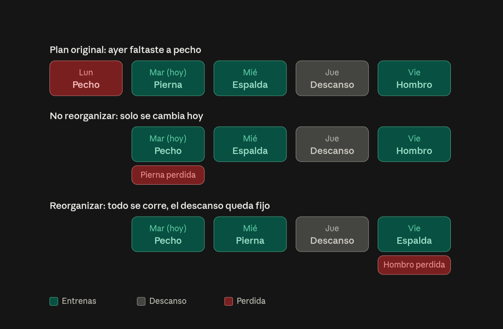

# Sesión perdida y reorganización de la semana (SP)

**Estado:** SP1–SP4 construidos (2026-11-05), sin recorrer en navegador. Pedido el 2026-11-05. Sirve a cualquier tipo de negocio (no hay `if (tipo == …)`); pesa más en entrenador personal y estudio, donde el día cuenta al entrenar.

## 1. Qué resuelve

Hoy, si el miembro falta a un día de su rutina, ese día queda como no hecho, la racha gasta un congelador o se corta, y al día siguiente la app le muestra lo que toca ese día, sin acordarse del que perdió. En la vida real el miembro quiere recuperar la rutina que perdió (sobre todo si era la de pecho y no quiere saltársela), y a veces quiere correr toda la semana.

## 2. Reglas (decididas por el dueño)

| # | Regla | Decisión |
|---|---|---|
| 1 | Ver otros días | El miembro puede ver y **ejecutar cualquier rutina del plan en cualquier momento**. La sesión se registra con su **fecha real** (la de hoy), no con la del día al que pertenece la rutina. |
| 2 | Detectar la perdida | Si **ayer** tocaba entrenar y no entrenó, la app marca la rutina de ayer como **perdida**. Solo se ofrece la de ayer. Las anteriores quedan en el historial como perdidas y no se ofrecen. |
| 3 | Hoy es descanso | La app **sugiere** hacer la perdida. |
| 4 | Hoy toca entrenar | La app **pregunta**: ¿haces la perdida o sigues con la de hoy? |
| 4a | Sigue con la de hoy | La perdida queda perdida y no pasa nada más. |
| 4b | Hace la perdida | Se le pregunta si **reorganiza** la semana. |
| 4b-sí | Reorganiza | Se aplica la regla 5. |
| 4b-no | Solo cambia | Hoy hace la perdida; la rutina de hoy, que no se hace, queda **perdida**. El resto de la semana no cambia. |
| 5 | Regla de reorganizar | **Los descansos quedan fijos.** Las rutinas se corren en orden, saltando los descansos, **solo dentro de la semana** (lunes a domingo, `IsoWeekDay`). La que ya no cabe queda **perdida**. |
| 6 | Explicación al usuario | Antes de decidir, se le muestra qué pasa con su semana, de preferencia con un diagrama antes/después como el de arriba. |
| 7 | Si no está seguro | La pantalla de decisión incluye la nota: «Si no estás seguro, pregúntale a tu entrenador». Si tiene entrenador asignado, se muestra su nombre. |

**Prioridad:** primero lo básico, reglas 1 a 4 (con 4b-no). La reorganización (regla 5 y 4b-sí) puede venir después.

### Ejemplo de la regla 5

Plan L Pecho · M Pierna · X Espalda · J Descanso · V Hombro. Faltó el lunes; hoy es martes.

| | Mar | Mié | Jue | Vie | Perdida |
|---|---|---|---|---|---|
| No reorganizar | Pecho | Espalda | Descanso | Hombro | Pierna |
| Reorganizar | Pecho | Pierna | Descanso | Espalda | Hombro |

## 3. Choque con reglas que ya existen

La regla de qué toca cada fecha es una sola, `RoutineCalendar`, y la usan la racha y el cumplimiento. Hoy dice que **un día cuenta como hecho solo con registros de sus propias líneas**. Por eso, si el miembro hace el martes la rutina del lunes, hoy no cumple ni el lunes ni el martes. Este diseño cambia eso de forma explícita:

- Se agrega a Routines un registro de **ajustes del calendario por miembro y fecha**: «el 2026-11-04 se hizo el día *Pecho* en lugar de *Pierna*», «*Hombro* quedó perdida». `RoutineCalendar.Resolve` lo consulta, así que la racha y el cumplimiento siguen diciendo lo mismo de cada fecha. **No se reimplementa la regla en otro lado.**
- Con un ajuste, el día de hoy cuenta como hecho con los registros del día que se cambió (Pecho), no con los del original (Pierna).
- La sesión perdida que se recupera **no** vuelve atrás: el lunes sigue sin hacer en el cumplimiento. Lo que cambia es el martes, que ahora cuenta como hecho. Queda por decidir si la racha perdona ese lunes (pregunta abierta 1).
- La regla 1 (cualquier rutina, cualquier día) sin un ajuste es un registro libre: se guarda y suma a progreso y récords, pero no cumple ningún día. Así lo hace hoy «Hacer otro ejercicio hoy» con las alternativas.

## 4. Cómo encaja

- **Todo vive en Routines.** No hay escritura cruzada nueva ni puertos nuevos. Attendance ya cuenta el día por entrenamiento con `RoutineExerciseLogged`, sin saber de qué día era la rutina.
- **Sin proceso en segundo plano.** «Perdida» se deriva al leer, como el cumplimiento: ayer tocaba entrenar (`RoutineCalendar`) y no hay registros. Solo se persiste lo que decide el miembro: el cambio y la reorganización.
- **Rutinas rotativas** (`ScheduleMode.Rotating`): la regla 5 habla de semana y de descansos fijos, que en un ciclo no existen. Por eso en una rotativa «reorganizar» es **correr toda la rutina un día**: hoy la de ayer, mañana la de hoy, y así; los descansos también se corren y no se pierde ninguna. Se guarda una sola fila (`reason = shift`) con la fecha de hoy, que vale para esa fecha y todas las siguientes: `RoutineCalendar` atrasa el ciclo un día por cada corrida hasta esa fecha. Como sí cambia qué fechas son descanso, la racha lee esas filas.

## 5. Datos (borrador)

| Dónde | Qué |
|---|---|
| `routines.routine_day_overrides` (migración `V2_SP2_RoutineDayOverrides`) | `id`, `gym_id`, `member_id`, `routine_id`, `date`, `planned_day_id` (lo que tocaba), `performed_day_id` (lo que cuenta), `reason` (enum `routine_day_override_reason`: `swap` / `reorganize` / `shift`), `created_at`, `updated_at`. Índice único `(member_id, date)`. FK a la rutina en cascada y a los días con `NO ACTION`. |

«Perdida» no se guarda: un día que tocaba y no tiene registros de sus líneas ya es perdido, y la rutina que no cabe al reorganizar simplemente no queda en ninguna fecha. Por eso `performed_day_id` no es nulo. Una reorganización escribe una fila por cada fecha de la semana que cambia, en una transacción.

## 6. API y pantallas

- `GET /api/me/routines`: `today` trae `dayId` y, si hoy cambió, `plannedDayName` (lo que tocaba). Nuevo bloque `missedSession` (nulo si no hay nada que ofrecer): el día perdido, `todayIsRest`, la semana de hoy al domingo (`week`) y, si hoy toca entrenar, cómo queda con cada opción (`swap` y `reorganize`: en semanales corre la semana; en rotativas, con `shiftsCycle`, corre todo el ciclo y no pierde ninguna), con la rutina que se pierde en cada una, `isRotating`, y `trainerName` (quien asignó la rutina). La vista previa viaja aquí y no en un endpoint aparte: la misma función pura (`MissedSessionPlanner`) arma la vista previa y lo que se guarda.
- `POST /api/me/routines/missed-session` `{ performedDayId, reorganize }`: guarda el cambio y devuelve la rutina ya cambiada. 409 si no hay sesión perdida (ya decidió, ya registró algo hoy, ayer lo hizo); 422 si el día no es el de ayer o hoy es descanso.
- La tarjeta de inicio del miembro (`IRoutineTodayReader`) también muestra el día cambiado.
- **App del miembro (GO), `/app/rutina`:**
  - selector para ver y ejecutar cualquier día del plan (regla 1);
  - tarjeta «Ayer te faltó *Pecho*» (`MissedSessionCard`): en descanso, «Hacer *Pecho*» abre ese día sin guardar nada; en día de entrenamiento, «Hacer *Pecho*» / «Seguir con *Pierna*»;
  - al elegir hacerla, el diagrama antes/después de la semana con cada opción (`WeekDiagram`) y «Queda sin hacer: …»; la nota «Si no estás seguro, pregúntale a tu entrenador (nombre)»;
  - con el cambio guardado, el aviso «Hoy haces *Pecho* en lugar de *Pierna*: cuenta como la rutina de hoy».
- **Panel:** en el cumplimiento de la ficha del miembro (`AdherencePanel`), los días cambiados dicen «*Pecho* en lugar de *Pierna*» (`isChanged`, `plannedDayName`).

## 7. Etapas

| Etapa | Qué | Tests |
|---|---|---|
| **SP1** ✓ | Regla 1: ver y ejecutar cualquier día del plan, registro con fecha real (registro libre, no cumple día). La API ya lo permitía; se agregó el selector de día en `/app/rutina` y lo registrado hoy de otro día reabre ese día. | `RoutineLogTests` + `RoutineOtherDayUiTests` |
| **SP2** ✓ | `RoutineDayOverride` + migración; `RoutineCalendar.Resolve` recibe los cambios del miembro; el cumplimiento cuenta el día con los registros del día que se hizo. | `MissedSessionPlannerTests` (puros) + `MissedSessionTests` (Postgres, reloj del gym) |
| **SP3** ✓ | Reglas 2–4 con 4b-no: `MissedSessionPlanner.Detect`, bloque `missedSession`, `POST …/missed-session`, tarjeta en `/app/rutina`, día cambiado en la tarjeta de inicio y en el panel. | ídem + `MissedSessionUiTests` |
| **SP4** ✓ | Regla 5: en semanales corre la semana con los descansos fijos; en rotativas corre todo el ciclo un día (`shift`). Diagrama antes/después de las dos opciones. | ídem |

SP1 a SP3 es «lo básico» que pidió el dueño. SP4 puede venir después.

## 8. Decisiones tomadas al construir

Se construyó con las propuestas del propio documento; cualquiera se puede cambiar.

1. **Racha:** recuperar no perdona el día perdido: ayer sigue como fallo y gasta congelador. Cambiar y reorganizar no alteran qué fechas son de entrenamiento o descanso; correr el ciclo sí, y la racha lo tiene en cuenta desde esa fecha.
2. **Rutinas rotativas:** se ofrecen «solo cambiar» y «correr toda la rutina» (todo el ciclo un día, sin perder ninguna).
3. **Deshacer:** no hay en esta versión. Tampoco el entrenador puede cambiarlo desde el panel.
4. **Logros:** la sesión recuperada cuenta igual que una normal (los registros son los mismos).
5. **Aviso al entrenador:** no hay campana; lo ve en el cumplimiento de la ficha.
6. **Semana:** de lunes a domingo para todos los gyms.

Otras reglas que salieron al construir:

- Solo se ofrece si hoy todavía no registró nada y no hay un cambio para hoy: empezar con la de hoy es «seguir con la de hoy» (4a). «Seguir con…» solo oculta la tarjeta; no guarda nada.
- Solo si la rutina de ayer es la misma que la de hoy y el día perdido sigue vigente.
- En descanso no se guarda cambio: hacer la perdida es un registro libre (SP1), que el cumplimiento muestra como «fuera de plan».

## 9. Fuera de alcance

Recuperar sesiones de antes de ayer, mover sesiones a la semana siguiente y que el entrenador reorganice por el miembro.
